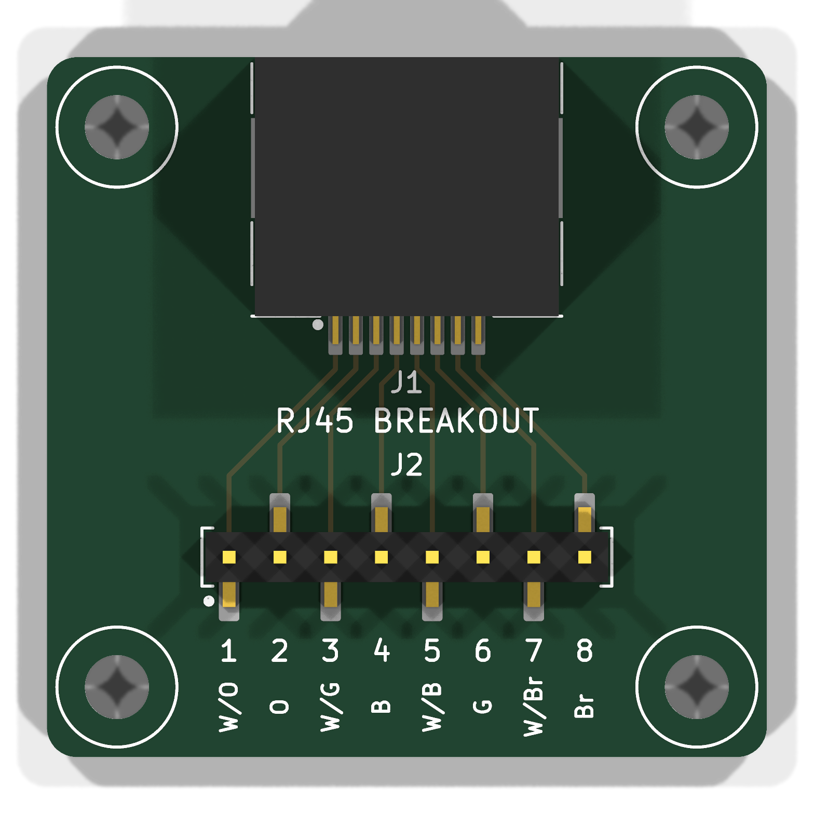
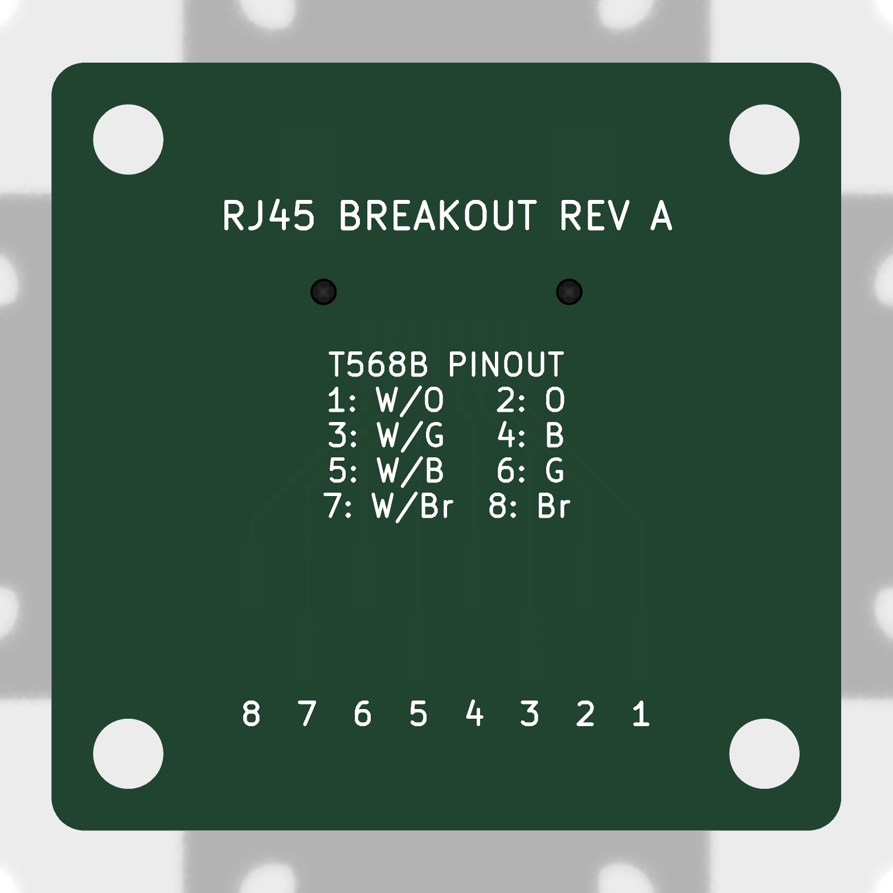
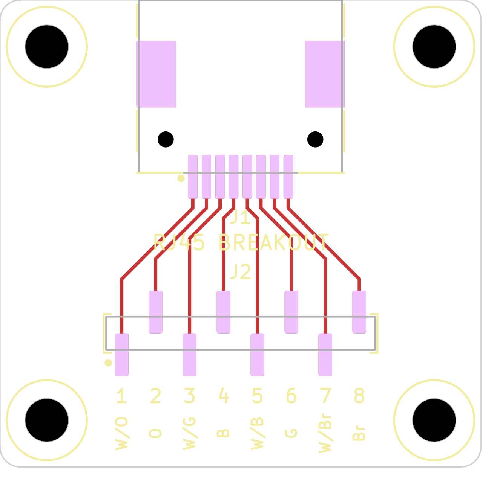
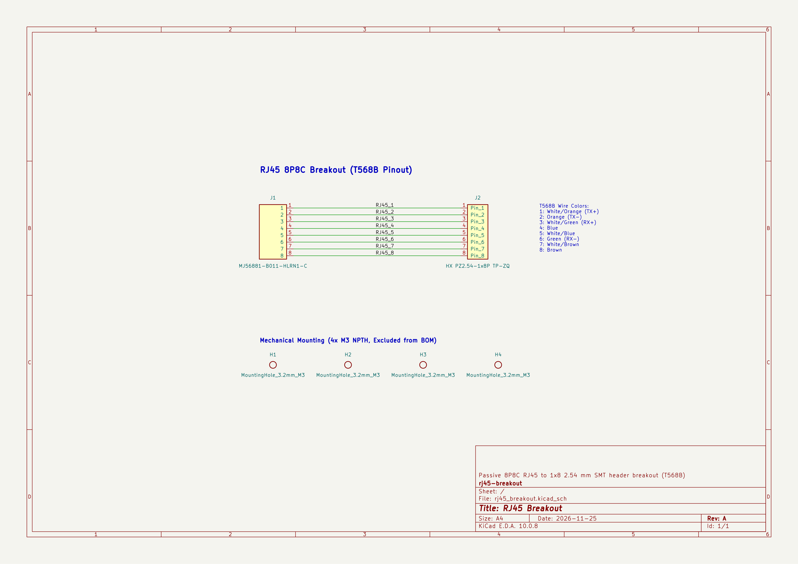

# RJ45 Breakout

A compact, turnkey 2-layer passive **RJ45 (8P8C) to 1x8 2.54 mm vertical male header** breakout board for workbench probing, logic analyzers, and breadboarding, built with `board-graph` (will be public shortly) in KiCad 10.

| Front 3D View | Back 3D View | Front Copper & Silkscreen |
|---|---|---|
|  |  |  |

## Schematic

## Key Specifications

| Parameter | Value |
|---|---|
| Dimensions | `36.0 x 35.0 mm` (`1.5 mm` corner fillets) |
| Stackup | 2-layer `1.6 mm` FR-4, 1 oz outer copper (`F.Cu` / `B.Cu`), ENIG or HASL, green soldermask / white silkscreen |
| Assembly target | 100% single-side (`F.Cu`) SMT for JLCPCB Economic PCBA turnkey assembly (`0` hand-soldered parts) |
| Routing | Pure planar `F.Cu` fanout (`24` segments, `0` vias), `0.25 mm` trace width, `>= 0.20 mm` clearance (`0.471 mm` min diagonal spacing) |
| Mounting | `4x` M3 NPTH corner holes (`3.2 mm` drill, `6.0 mm` screw-head keepout) at `(3.5, 3.5)`, `(32.5, 3.5)`, `(3.5, 31.5)`, `(32.5, 31.5)` mm |
| Jack orientation | Right-angle unshielded tab-up 8P8C (`J1`) flush with north edge (`Y = 0`), `2x 1.20 mm` locating pegs + `2x 2.94 x 5.00 mm` SMT anchors |
| Header orientation | Staggered SMD vertical 1x8 `2.54 mm` male header (`J2`), `9.20 mm` total height (`3.20 mm` insulator + `6.00 mm` pin) |

## Bill of Materials

| Ref | Function | Manufacturer | MPN | Supplier Part (LCSC) | Package / Mount | Rated Current | Datasheet |
|---|---|---|---|---|---|---|---|
| `J1` | 8P8C RJ45 jack (tab-up, unshielded, no magnetics/LEDs) | Heling | `MJ56881-B011-HLRN1-C` | `C501473` | R/A SMT + 2x NPTH pegs | `1.5 A` | [C501473 PDF](hardware/reference/Heling_MJ56881-B011-HLRN1-C_C501473.pdf) |
| `J2` | 1x8 2.54 mm vertical male pin header | hanxia | `HX PZ2.54-1x8P TP-ZQ` | `C42453975` | Staggered SMD vertical | `3.0 A` | [C42453975 PDF](hardware/reference/Hanxia_HX_PZ2.54-1x8P_TP-ZQ_C42453975.pdf) |
| `H1`..`H4` | Corner M3 mounting holes | N/A | N/A (NPTH) | Excluded from BOM/CPL | `3.2 mm` NPTH | N/A | N/A |

- Parametric STEP 3D models generated from datasheet dimensions live in [board/part_models.py](board/part_models.py) and [board/models/](board/models/).

## T568B Pinout (West to East on Front Face)

Pins run monotonically west-to-east (`1` on the left, `8` on the right) on both `J1` and `J2`, labeled with T568B wire colors on front silkscreen and mirrored `8..1` plus a T568B legend on back silkscreen:

| Pin | Net | T568B Wire Color | Silkscreen Label | Ethernet Pair |
|---|---|---|---|---|
| `1` | `/RJ45_1` | White / Orange | `W/O` | Pair 2 (`TX+` in 100BASE-TX) |
| `2` | `/RJ45_2` | Orange | `O` | Pair 2 (`TX-` in 100BASE-TX) |
| `3` | `/RJ45_3` | White / Green | `W/G` | Pair 3 (`RX+` in 100BASE-TX) |
| `4` | `/RJ45_4` | Blue | `B` | Pair 1 |
| `5` | `/RJ45_5` | White / Blue | `W/B` | Pair 1 |
| `6` | `/RJ45_6` | Green | `G` | Pair 3 (`RX-` in 100BASE-TX) |
| `7` | `/RJ45_7` | White / Brown | `W/Br` | Pair 4 |
| `8` | `/RJ45_8` | Brown | `Br` | Pair 4 |

## Verification Summary (`board-graph v0.32.2`)

All design, layout, visual, and independent verification gates pass on `board/rj45_breakout.kicad_pcb`:
- **ERC (`kicad-cli` 10.0.8):** `0` errors, `0` warnings ([erc.json](board/reports/verification/checks/erc.json))
- **DRC + schematic parity (`kicad-cli` 10.0.8):** `0` violations, `0` schematic parity errors, `0` unconnected items, `0` footprint mismatches ([drc.json](board/reports/verification/checks/drc.json))
- **Route quality & track craft:** `0` errors, `0` warnings, `0` failing items, `0` inspection candidates ([route-quality.json](board/reports/verification/checks/route-quality.json), [track-craft.json](board/reports/visual_review/track-craft.json))
- **Visual & independent verification reviews:** Passed bidirectional physical mating, silkscreen clearances, and independent file-level reproduction ([board-critic.md](board/reports/visual_review/board-critic.md), [reproduced.md](board/reports/verification/reproduced.md), [independent-review.json](board/reports/verification/independent-review.json))

## Fabrication & Assembly Files

Provisional JLCPCB fabrication and SMT assembly outputs for quoting live under [board/reports/quote_files/fab/](board/reports/quote_files/fab/):
- Gerbers & Excellon drills: [RJ45_BREAKOUT.zip](board/reports/quote_files/fab/RJ45_BREAKOUT.zip)
- JLCPCB SMT BOM & CPL: [RJ45_BREAKOUT_SMT_bom.csv](board/reports/quote_files/fab/RJ45_BREAKOUT_SMT_bom.csv), [RJ45_BREAKOUT_SMT_positions.csv](board/reports/quote_files/fab/RJ45_BREAKOUT_SMT_positions.csv)
- Assembly comparison & quote notes: [quote-options.md](board/reports/quote_files/quote-options.md)

## Repository Layout

- `board/`: KiCad 10 project, schematic, PCB, custom footprints, STEP models, design rules, contracts, and `board/reports/` evidence
- `hardware/reference/`: Connector datasheets and verified mechanical/stock specs (`parts.json`)
- `tasks/`: Committed routing task specs (`tasks/batch1/`) and routing execution receipt (`tasks/run-157997c4.jsonl`)
- `tools/`: `board_graph.json` pipeline definition, site config, and git-tracked transition records (`tools/board_graph_records/`)
- `docs/`: Product truth statement (`PRODUCT_TRUTH.md`), routing notes, and order checklists
